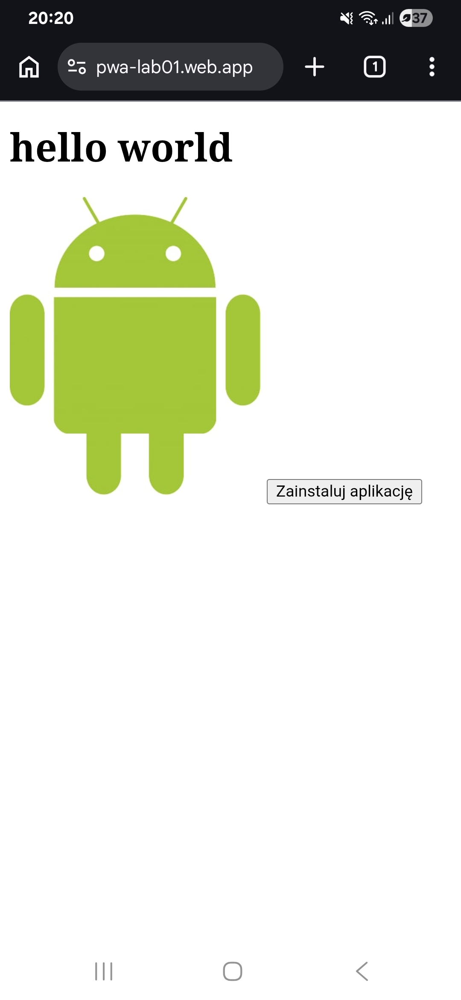

# Lab 01
## Co zostało zrealizowane
Stworzono aplikację PWA wraz z możliwością instalcji. Otrzymano wyniki Lighthouse: Accessibility 100, Best Practices 100.
## Uruchomienie
Przejść do katalogu lab_01/public i wykonać polecenie: npx serve a następnie otworzyć w przeglądarce adres: http://localhost:3000
## Opublikowana aplikacja
Adres aplikacji: https://pwa-lab01.web.app
## Zrzut ekranu aplikacji
