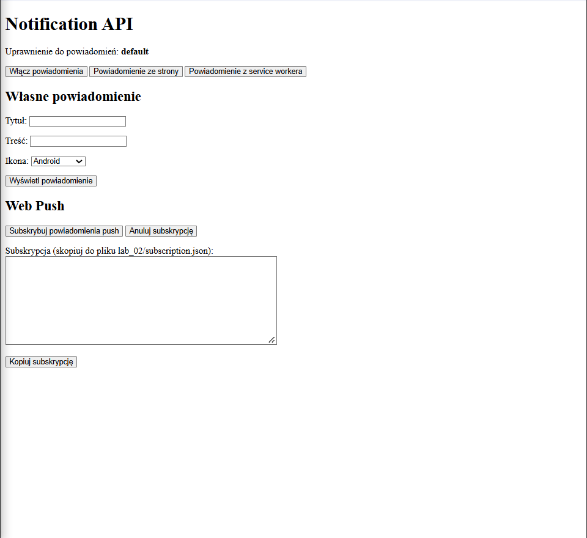
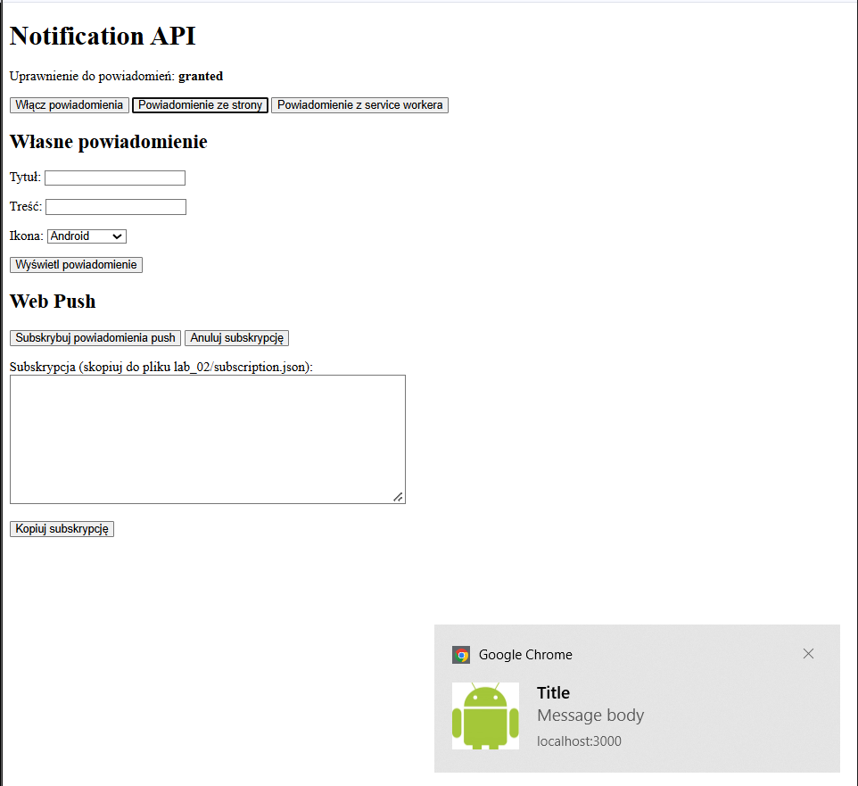
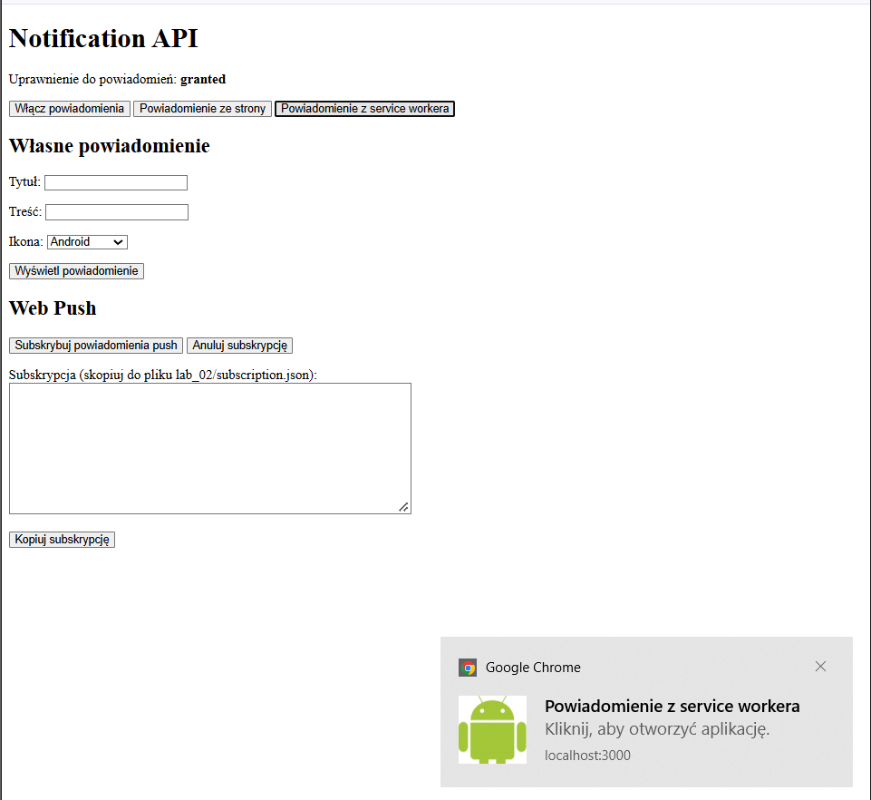
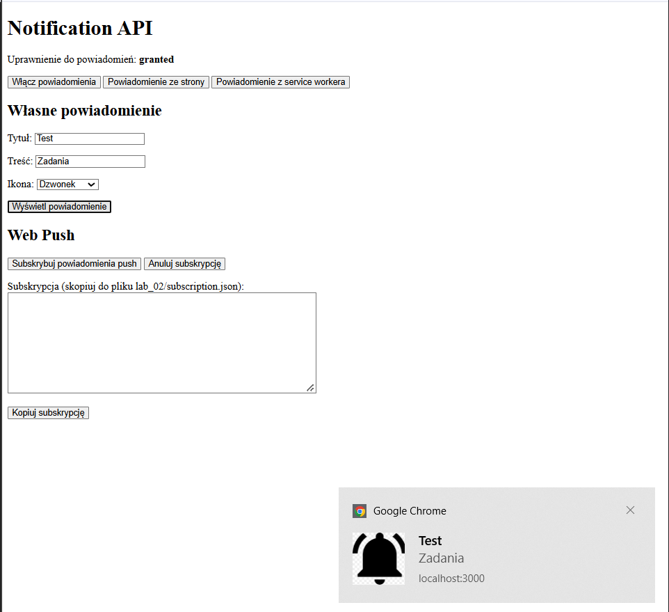
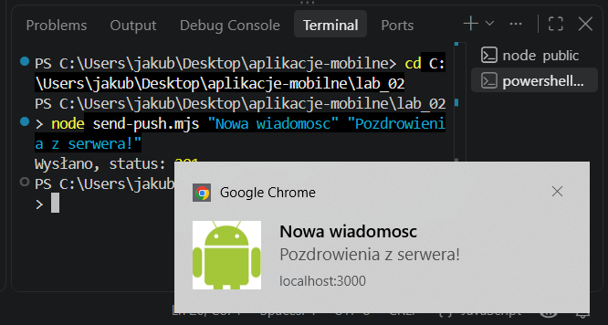

# Lab 02 – Powiadomienia i Web Push

## Co zostało zrealizowane
Utworzono aplikację PWA obsługującą powiadomienia z service workera oraz Web Push. Dodano formularz z polami na tytuł i treść oraz wyborem trzech ikon. Dodano także obsługę subskrypcji.

## Uruchomienie
W folderze public wpisać polecenie npx serve.

## Opublikowana aplikacja
https://lab02-1df5c.web.app

## Zrzuty ekranu

