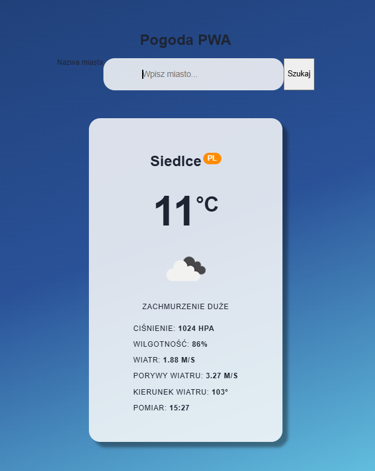
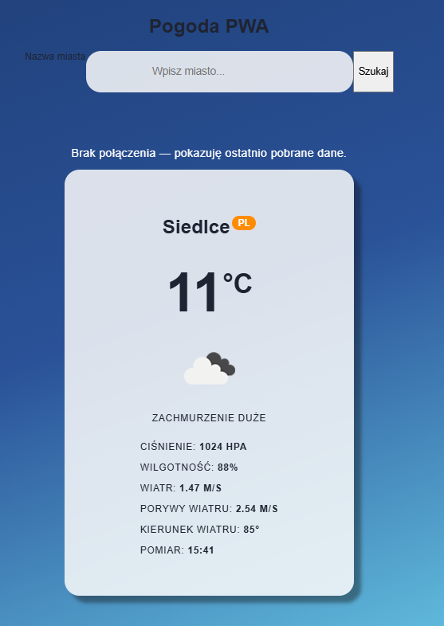

## LAB_03 - pogoda

## Co zostało zrealizowane

Aplikacja pogodowa w React z Api OpenWeatherMap pokazującą pogodę. Aplikacja działa również w trybie offline.

## Uruchomienie

W folderze lab_03 wykonać polecenia "npm run build
" oraz "npm run preview".

## Przykłady działania

