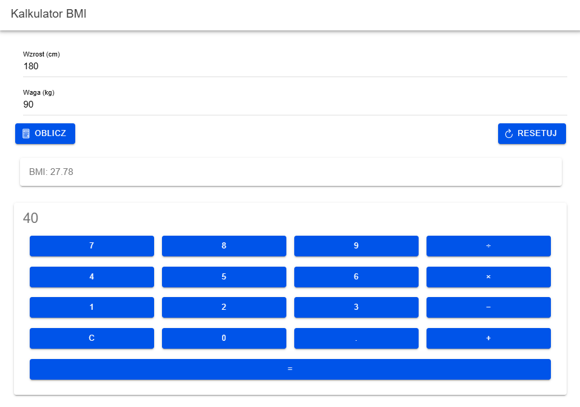

# Laboratorium 04 – Ionic React

## Co zostało zrealizowane
Aplikacja wykonana w Ionic React, zawierająca kalkulator BMI oraz prosty kalkulator matematyczny.

## Uruchomienie
Otworzyć terminal w folderze lab_04, wykonać polecenie ionic serve oraz otworzyć http://localhost:8100.

## Zrzuty ekranu

### Kalkulator matematyczny oraz BMI – wyniki
