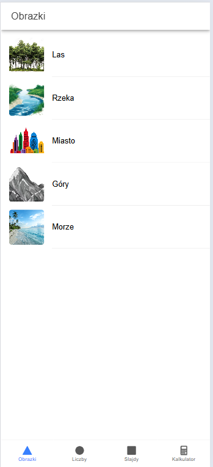
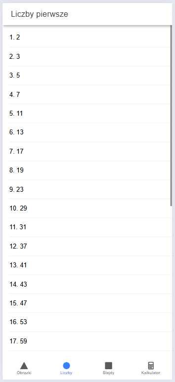
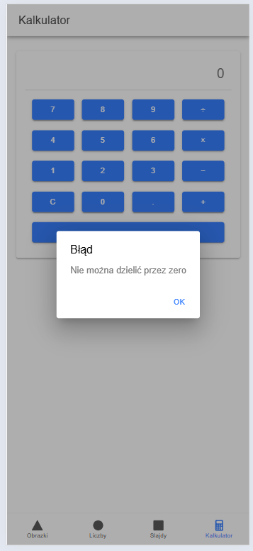

# Laboratorium 05 – Podstawowe komponenty Ionic React

## Co zostało zrealizowane

Zostały zrealizowane zadania 1-5

1. Kalkulator na zakładce
2. Alert
3. Lista z Obrazkami
4. Liczby pierwsze
5. Pokaz slajdów

## Uruchomienie

W folderze lab_05 należy wykonać polecenie npm install, a następnie ionic serve.

### Lista obrazków

### Liczby pierwsze i toast

### Pokaz slajdów

### Kalkulator i alert

