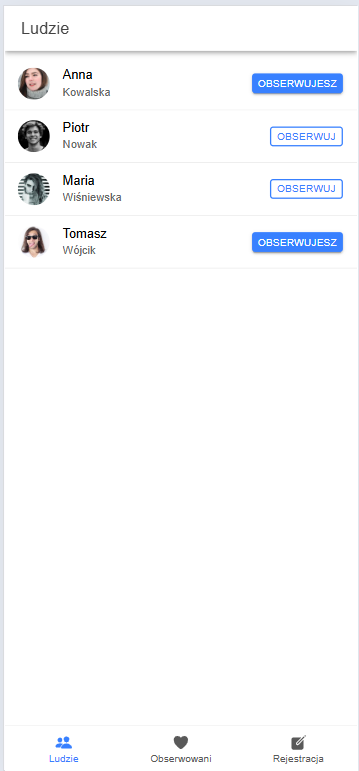
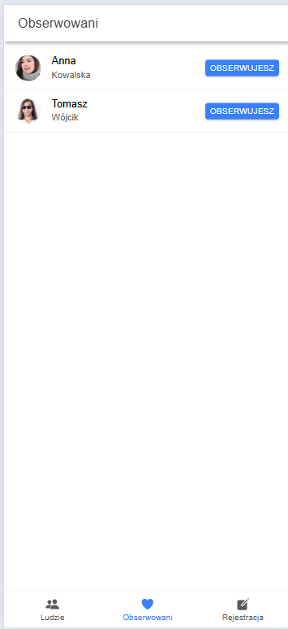
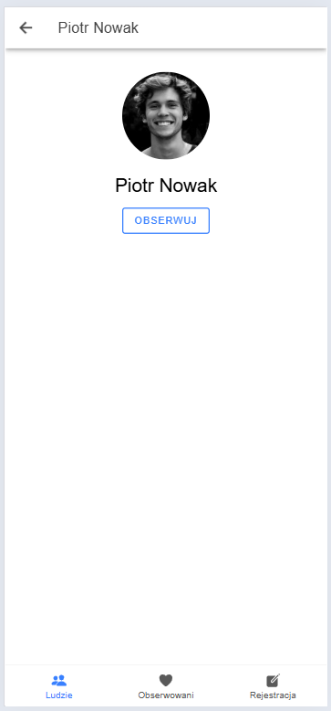
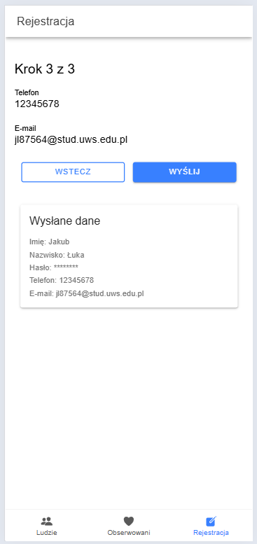

# Laboratorium 06 – Nawigacja, wspólny stan i formularze w Ionic React

## Co zostało zrealizowane

Zostały zrealizowane zadania 1-5

1. Wspólny stan — Zustand
2. Widok szczegółów — routing z parametrem
3. Pull-to-refresh — IonRefresher
4. Formularz krokowy — react-hookform + Swiper
5. Podsumowanie formularza

## Uruchomienie 

W folderze lab_06 należy wykonać polecenie npm install, a następnie ionic serve.

### Lista osób

### Obserowani

### Szczegóły osoby

### Rejestracja

